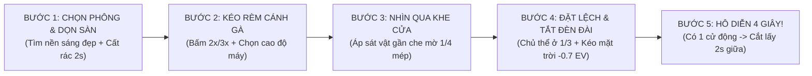

# Hệ Thống Hóa Đầy Đủ Logic Điện Ảnh & Bố Cục Cảnh Quay (Bản Tổng Hợp Từ A–Z)

**Độ sang của một cảnh quay không đến từ máy ảnh đắt tiền, mà đến từ kỷ luật làm phép trừ: tắt đèn trần đón ánh sáng xiên, khóa tĩnh điện thoại ở tiêu cự 2x–3x để cắt bỏ 70% rác thị giác, và chỉ cắt lấy 2 giây ở giữa khi hành động đang diễn ra.**

Tài liệu này tổng hợp và hệ thống hóa toàn bộ nền tảng lý thuyết, các ẩn dụ sư phạm thực chiến, trình tự suy luận tại hiện trường và các bài giải phẫu bối cảnh thực tế đã được trao đổi xuyên suốt các luồng lịch sử (bao gồm bản gốc `bocucquay.html` 2.797 dòng tại `kenh-goc`, luồng lý thuyết 3 bán kính `3d37374b`, luồng thực địa 13 lượt `81452822`, luồng tổng kết nguyên lý `b90158ad` và luồng phân cảnh máy tính `39b7f444`).

---

## PHẦN 0: LÝ GIẢI TẠI SAO TRANG `bocucquay.html` HIỆN TẠI LẠI VIẾT THIẾU?

Qua đối chiếu lịch sử trò chuyện và kho mã nguồn, có **2 nguyên nhân trực tiếp** khiến trang `https://kenh.fedu.vn/dinh-dang/bocucquay.html` hiện tại bị thiếu hụt nhiều quy tắc và ẩn dụ quan trọng:

1. **Các quy tắc suy luận sâu ("Ẩn dụ Sân khấu 5 bước", "Đôi đũa 2x/3x gắp 1 món", trình tự cứng "3 Nhịp – 6 Chữ" và 4 bài toán thực địa) nằm ở nhánh thảo luận ngày 28/10/2026 (`81452822` & `3d37374b`) chưa được gộp ngược vào file web:**
   - Trang `bocucquay.html` gốc được khởi tạo ngày `20/10/2026` (luồng `6c576fcd`) theo cấu trúc 6 chữ rời rạc: **Đường – Động – Sáng – Giờ – Tĩnh – Vào**.
   - Đến ngày `28/10/2026` (luồng `81452822`), khi đi thực tế tại quán cà phê, hành lang hồ bơi, hội trường và bãi đỗ xe buổi trưa, anh Việt phát hiện ra rằng: *nhớ 6 chữ rời rạc vẫn không biết bắt đầu từ đâu khi đứng trước một khung cảnh lộn xộn*. Từ đó, toàn bộ hệ thống mới được nâng cấp lên **Trình tự suy luận 3 Nhịp (`Giờ → Sáng → Đường → Tĩnh → Động → Vào`)**, **Ẩn dụ Sân Khấu 5 Bước**, **Công thức 5 Lớp (`Nền – Máy – Viền – Điểm – Động`)** và **Mẹo cơ thể "Nhìn lén qua cạnh cột"**. Tuy nhiên, các đúc kết đắt giá này mới nằm trong biên bản chat mà chưa được cập nhật vào HTML.
2. **Đợt rút gọn toàn trang `kenh.fedu.vn` ngày 05/11/2026 (luồng `f6c90a66`) đã cắt 90% dung lượng trang và ẩn các khối dưới quyền Admin:**
   - Bản gốc `bocucquay.html` (hiện được lưu trữ nguyên trạng tại `/Users/vietmac/Documents/CODE/kenh-goc/dinh-dang/bocucquay.html`) dài **2.797 dòng (184 KB)**, có đầy đủ 4 cơ chế vật lý cho từng quy tắc, 18 video mẫu quốc tế giải phẫu 3 lớp (Tiền cảnh – Trung cảnh – Hậu cảnh), bảng 8 ngành nghề và lộ trình 3 cấp độ bài tập thành phố.
   - Khi rút gọn giao diện ngày `05/11/2026`, file `/Users/vietmac/Documents/CODE/kenh.fedu.vn/dinh-dang/bocucquay.html` bị cô đọng xuống chỉ còn **267 dòng (24 KB)**, mỗi quy tắc chỉ còn 1 đoạn văn ngắn và 1 cặp thẻ Đúng/Sai; đồng thời nhiều khối bị gắn thuộc tính `data-admin=""` (chỉ hiện khi có `?full=1` hoặc mở khóa mã `0070`).

Dưới đây là bản **Hệ thống hóa Logic Đầy Đủ 100%** hợp nhất cả lý thuyết gốc lẫn toàn bộ phương pháp suy luận thực chiến để anh Việt dùng làm giáo trình giảng dạy và cập nhật lại trang web.

---

## PHẦN 1: CHẨN ĐOÁN GỐC RỄ & HAI ẨN DỤ CỐT LÕI ĐỂ HỌC VIÊN HIỂU NGAY TRONG 3 PHÚT

### 1.1. Ba thói quen vô thức làm khung hình bị "phẳng và rẻ tiền"

Người mới khi thấy cảnh quay của mình tối và rối thường nghĩ do điện thoại kém hoặc do phòng làm việc không sang. Thực tế, cùng một chiếc điện thoại và cùng một góc bàn, khung hình bị hỏng như camera giám sát là do **3 thủ phạm lúc bấm máy**:

* **Thủ phạm 1 — Bật đèn huỳnh quang/LED trần nhà trắng bệch:** Ánh sáng từ đỉnh đầu dội thẳng xuống làm mọi bề mặt phẳng lì, xóa sạch bóng đổ tự nhiên, khiến da mặt bóng dầu và màu gỗ, màu vải nhợt nhạt như phòng chờ bệnh viện.
* **Thủ phạm 2 — Để mặc định góc rộng `1x` và cầm tay lia máy vô định:** Khi chưa chọn được góc đặt máy có bố cục, người quay thường lia điện thoại qua lại để lấp trống. Góc rộng `1x` (24mm) gom cả ổ điện, dây sạc, giỏ giấy ăn, lưng người lạ vào khung hình, cộng với cổ tay rung lắc làm người xem chóng mặt.
* **Thủ phạm 3 — Giữ nguyên 1,5 đến 2 giây đứng chờ ở đầu cảnh & dí sản phẩm vào giữa màn hình:** Thói quen bấm nút quay, nhìn màn hình kiểm tra đèn đỏ rồi mới bắt đầu cử động tay làm lộ rõ sự dàn dựng, khiến người xem vuốt qua ngay từ giây đầu tiên.

### 1.2. Ẩn dụ số 1: "Mắt Thường Là Mâm Cỗ 10 Món — Ống Kính 2x/3x Là Đôi Đũa Gắp Đúng 1 Món"

* **Tại sao nhìn bằng mắt thường thì đẹp mà giơ máy `1x` lên chụp lại nản?**
  * Ngoài đời thật, não con người có khả năng **tự động lọc rác**: khi bạn nhìn một bình hoa hay dãy núi, não tự động lờ đi chiếc ô tô đậu bên dưới hay cái giỏ giấy ăn màu vàng trên bàn.
  * Nhưng ống kính `1x` của điện thoại thì không biết lọc: nó bê nguyên "một mâm cỗ 10 món" bày ra trên màn hình phẳng 2D, làm món nọ đè lên món kia và dính cả "xương xẩu" (rác thị giác).
* **Tư duy Đạo diễn hình ảnh:**
  * Không bao giờ quay cả cái mâm (`1x`).
  * Hãy dùng nút **`2x` hoặc `3x`** làm **"đôi đũa"** để gắp tách riêng từng "món ngon" đang có ánh sáng đẹp ra từng đĩa nhỏ. Một bối cảnh có 3 món đẹp nghĩa là bạn đứng nguyên một chỗ gắp được 3 cảnh quay riêng biệt nối tiếp nhau.

### 1.3. Ẩn dụ số 2: "Màn Hình Điện Thoại Là Sân Khấu Kịch Nhỏ" — Công Thức 5 Bước Dựng Sân Khấu 4 Giây

Để học viên không phải nhớ các thuật ngữ nhiếp ảnh như *tiền cảnh, hậu cảnh, tiêu cự, phơi sáng*, hãy hướng dẫn họ hình dung **màn hình điện thoại là một sân khấu kịch nhỏ**, còn quay một cảnh phim 4 giây là **5 bước chuẩn bị sân khấu trước khi hô "Diễn!"**:

1. **Bước 1 — Chọn Phông & Dọn Sàn (Đừng dựng sân khấu trước bãi rác):**
   * *Ẩn dụ:* Không ai dựng sân khấu kịch trước chỗ có người lạ đang đứng quay lưng lố nhố hay để rác vương vãi trên sàn diễn. Người bình thường nhìn "Chủ thể" trước nên bị dính rác ở nền sau; người quay điện ảnh nhìn **"Mảng Nền Sạch & Ánh Sáng" trước tiên** rồi mới đặt máy hướng vào mảng nền đó.
   * *Thao tác 3 giây:* Quét mắt tìm một tấm phông gọn có ánh sáng ấm (vách gỗ, tường đá, tán cây xanh có nắng hoặc đèn vàng). Nhìn xuống mặt bàn ("sàn sân khấu"): thấy giỏ giấy ăn màu chói, chai nhựa hay khăn nhăn thì dùng tay cất ngay xuống gầm bàn.
2. **Bước 2 — Bấm `2x/3x` Để "Kéo Rèm Che Cánh Gà" (Cắt bỏ lộn xộn hai bên):**
   * *Ẩn dụ:* Để camera ở mức `1x` giống như mở toang cả hai bên cánh gà, làm khán giả thấy hết dây điện, hậu trường và người ngồi bàn bên cạnh.
   * *Thao tác 2 giây:* Bấm ngay nút **`2x` hoặc `3x`** trên màn hình như kéo rèm khép nhỏ sân khấu lại, kết hợp chọn 1 trong 3 cao độ mặt máy để cắt nốt rác còn sót:
     * Nếu bên dưới vướng đầu người lạ hoặc xe cộ $\rightarrow$ **Ngóc mặt máy lên cao** (cắt từ trên đỉnh đầu người trở lên).
     * Nếu xung quanh ngang mắt bị rối $\rightarrow$ **Hạ máy sát mặt bàn** hoặc **chúc máy góc $45^\circ$ xuống bàn**.
     * Nếu nền trước mặt đã sạch $\rightarrow$ **Đặt máy ngang tầm mắt/ngực** tựa cố định lên bàn.
3. **Bước 3 — Nhìn Qua "Một Khe Cửa" (Tạo chiều sâu không gian 3D):**
   * *Ẩn dụ:* Nhìn thẳng tuột vào sân khấu trống trơn thì rất phẳng. Nhưng nếu bạn đứng nép sau một cánh cửa mở hé, một tấm rèm hay một bình hoa để nhìn vào sân khấu, khán giả sẽ có cảm giác cuốn hút như đang tình cờ khám phá một góc riêng tư.
   * *Thao tác 2 giây:* Dịch nhẹ điện thoại sang ngang $10\text{–}15\text{cm}$ để mép rèm, cạnh cột gỗ, cành hoa hoặc tán lá che mờ đi khoảng $1/4$ mép màn hình (tạo lớp *Tiền cảnh mờ*).
4. **Bước 4 — Đặt "Diễn Viên Chính" Đứng Lệch & Tắt Bớt Đèn Khán Đài (`-0,7 EV`):**
   * *Ẩn dụ:* Trên sân khấu, diễn viên chính đứng cứng ngay chính giữa như chào cờ thì rất gượng; họ luôn đứng lệch sang đường kẻ $1/3$ và chừa khoảng trống trước mặt để nhìn. Đồng thời, trong rạp hát, vì muốn khán giả tập trung vào diễn viên nên phải **hạ tối đèn khán đài xung quanh xuống**, nghĩa là chỉ giữ lại ánh đèn rọi vào diễn viên.
   * *Thao tác 2 giây:* Đặt vật chính (cuốn sổ da, ly trà, bông hoa, hoặc người ngồi) vào đường kẻ dọc $1/3$. Chạm ngón tay giữ 2 giây vào vật chính để khóa nét (`AE/AF Lock`) rồi **kéo biểu tượng ông mặt trời đi xuống nửa đốt ngón tay (`-0,7` đến `-1,0 EV`)** — vùng xung quanh lập tức trầm tối xuống giấu sạch rác, còn ánh nắng trên diễn viên chính rực sáng lên.
5. **Bước 5 — Hô "Diễn!" Trong 4 Giây & Hạ Màn (Lấy 2 giây giữa):**
   * *Ẩn dụ:* Sân khấu đẹp, ánh đèn đẹp mà diễn viên đứng bất động như tượng thì đó là bức ảnh chụp chứ không phải vở kịch.
   * *Thao tác 4 giây:* Giữ yên điện thoại $\rightarrow$ Bấm nút Quay (Mở màn) $\rightarrow$ Cho "diễn viên" thực hiện 1 cử động chậm rãi (tay mở sổ, rót nước, nhấc tách trà, hoặc gió lay lá) $\rightarrow$ Đếm nhẩm `1 - 2 - 3 - 4` rồi Bấm Dừng (Hạ màn). Khi dựng, cắt bỏ giây đầu và giây cuối, chỉ lấy đúng **2 giây đang diễn ở giữa**.

> **Khẩu quyết 12 chữ bỏ túi khi đi quay:**
> **Chọn phông sạch $\rightarrow$ Bấm 2x che cánh gà $\rightarrow$ Ghé qua khe cửa $\rightarrow$ Đặt lệch dìm nền $\rightarrow$ Quay 4 giây có động tác!**

---

## PHẦN 2: HỆ THỐNG HÓA "3 NHỊP – 6 QUY TẮC" THEO ĐÚNG THỨ TỰ SUY LUẬN TẠI HIỆN TRƯỜNG

### 2.1. Tại sao phải sắp xếp lại 6 chữ theo trình tự cứng: `GIỜ → SÁNG → ĐƯỜNG → TĨNH → ĐỘNG → VÀO`?

Khi học lý thuyết, khẩu quyết **Đường – Động – Sáng – Giờ – Tĩnh – Vào** giúp dễ thuộc tên 6 quy tắc. Nhưng khi bước vào một căn phòng hay quán cà phê thực tế, nếu chưa tìm nguồn sáng mà đã vội tìm "Đường dẫn" hay "Chuyển động", người quay sẽ đặt máy vào vùng tối phẳng lì.

Vì vậy, tại hiện trường, não người quay phim luôn chạy tự động theo **3 Nhịp kế tiếp nhau**:

* **NHỊP 1 — TÌM MÓN NGON BẰNG MẮT THƯỜNG (Chưa rút điện thoại):** **`① GIỜ` + `② SÁNG`** $\rightarrow$ Trả lời câu hỏi: *"Ánh nắng hay đèn vàng đang chiếu xiên vào đâu làm vật đó phát sáng hoặc đổ bóng dài?"* (Ánh sáng ở đâu, sân khấu ở đó).
* **NHỊP 2 — DÙNG ĐŨA GẮP RIÊNG & DỰNG SÂN KHẤU (Đưa điện thoại lên):** **`③ ĐƯỜNG` + `④ TĨNH`** $\rightarrow$ Trả lời câu hỏi: *"Làm sao cắt bỏ rác xung quanh món đó, tạo chiều sâu 3 lớp và khóa cứng khung hình?"*
* **NHỊP 3 — CHO NHÚC NHÍCH 4 GIÂY & CẮT KHÚC GIỮA (Bấm nút quay & dựng):** **`⑤ ĐỘNG` + `⑥ VÀO`** $\rightarrow$ Trả lời câu hỏi: *"Cái gì sẽ cử động trong 4 giây tới và cắt ở mốc nào để nối mượt?"*

---

### 2.2. Giải phẫu chi tiết Nhịp 1: Xử lý Thời gian & Ánh sáng (`① GIỜ` + `② SÁNG`)

#### Quy tắc ① — GIỜ: Bóng nắng xiên hai khung giờ vàng & Quy tắc Đèn điểm buổi tối (Little Lights)

* **Luận điểm cốt lõi:** Bóng đổ dài là chữ viết của mặt trời; nó cho người xem cảm nhận được thời gian trong ngày và biến một mặt bàn phẳng lì thành không gian nổi khối 3D.
* **Cơ chế vật lý & 3 quy tắc theo khung giờ:**
  1. **Khung giờ vàng ban ngày (`06h30–08h30` sáng sớm & `16h00–17h30` hoàng hôn):**
     * Mặt trời nằm thấp ở đường chân trời nên tia nắng chiếu xiên qua cửa sổ, tạo ra các vệt bóng đổ dài cắt ngang mặt bàn và tường nhà thành những mảng sáng – tối đan xen (Shadow Play), làm nổi rõ vân gỗ và thớ vải.
     * *Lưu ý khi quay hoàng hôn:* Bắt buộc khóa cân bằng trắng (White Balance / AE/AF Lock) để điện thoại không tự động kéo sắc vàng mật ong ấm áp về màu trắng lạnh.
  2. **Tại sao tránh nắng trưa (`11h00–14h00`) & Quy tắc cứu cánh khi bắt buộc phải quay giữa trưa:**
     * *Lý do:* Lúc 12 giờ trưa, mặt trời chiếu thẳng từ đỉnh đầu xuống làm mặt sân bê tông cháy trắng lóa, bóng đổ cụt ngủn chui tọt xuống gầm vật thể, còn nếu quay mặt người thì hốc mắt bị tối đen.
     * *Quy tắc cứu cánh khi đi thực tế lúc 11h–14h trưa:* Tuyệt đối **bỏ 100% mặt đất/mặt sân bê tông phơi nắng bên dưới**. Hãy đứng lùi vào dưới mái hiên râm mát nhìn ra ngoài, hoặc bấm `2x/3x` ngước ống kính lên cao vào các tán cây xanh, mái ngói gỗ, dãy núi xa (nơi lá cây và sương làm mềm ánh nắng trưa).
  3. **Buổi tối trong nhà (`18h00–22h00`) — Quy tắc Đèn điểm tầm thấp (Little Lights Only):**
     * Học viên đi làm cả ngày thường chỉ rảnh buổi tối để quay bài tại nhà.
     * *Kỷ luật bắt buộc:* **Tắt ngay toàn bộ đèn huỳnh quang / đèn LED trắng trên trần nhà!** Thay vào đó, chỉ bật **2 đến 4 nguồn sáng điểm nhỏ tầm thấp** (đèn bàn chao vải, đèn cây góc sofa, đèn hắt kệ sách, đèn màn hình hoặc ngọn nến thơm) có nhiệt độ màu vàng ấm (`2700K–3200K`) đặt ngang tầm tay. Khi quay cận cảnh rót trà hoặc viết sổ, hãy đặt chiếc bình thủy tinh chắn trước bóng đèn bàn để tạo hiệu ứng ngược sáng giả lập y hệt nắng chiều.
* **Ví dụ mẫu đối chứng (từ Kho Ý Tưởng & Thực tế):**
  * `@framebygeorge` (Mã `DdhHCL6OOfK` & `DdW1eYoO7Nb`): Quay trọn video trong 30 phút lúc 7h00 sáng và 16h30 chiều; dùng chính bóng đổ hình học của chấn song cửa sổ và rèm sáo cắt chéo qua cốc cà phê làm bố cục dẫn mắt.
  * `@iman.lizi` (Mã `DeZJOgZoRew` — *The Evening Rule: Little Lights Only*): Tắt sạch đèn trần lúc 18h00, phối 4 tầng đèn bàn ấm và nến thơm để tạo chiều sâu nhiều lớp cho phòng khách buổi tối.
  * Kênh **Momi Trendii (`@hoangnga_home`)**: Luôn đón vệt nắng xiên buổi sáng trong gian bếp hoặc bật đèn vàng ấm ngang tầm kệ vào buổi tối.

#### Quy tắc ② — SÁNG: Ánh nắng ven (Rim Light), Ngược sáng (Backlight) & Cơ chế kéo `-0,7 EV`

* **Luận điểm cốt lõi:** Đường viền nắng phía sau tách chủ thể nổi hẳn khỏi nền tường tự nhiên hơn bất kỳ chế độ xóa phông giả lập nào.
* **Cơ chế vật lý & 3 nguyên tắc xử lý ánh sáng:**
  1. **Xoay góc máy $90^\circ\text{–}135^\circ$ so với cửa sổ (Tạo đường viền Rim Light):**
     * Đứng quay lưng vào cửa sổ (thuận sáng 100%) làm ánh sáng dội thẳng vào mặt phẳng lì, mất sạch bóng đổ.
     * Khi bạn xoay góc đặt máy lệch **$90^\circ$ đến $135^\circ$ so với nguồn sáng** (đưa cửa sổ hoặc đèn bàn ra phía sau chéo của chủ thể), ánh sáng sẽ vẽ một đường viền sáng sắc nét quanh mái tóc, bờ vai, gò má, vành cốc gốm hoặc cánh hoa.
  2. **Hiện hình chất liệu vô hình bằng "Ngược sáng + Nền tối":**
     * Làn khói trà nóng, hơi nước máy xông, hạt bụi nắng, bọt gas hay tia nước chỉ phát sáng lấp lánh khi được **chiếu ngược sáng VÀ nằm đè lên một mảng nền tối phía sau** (góc tường khuất sáng, rèm tối màu, tán cây râm mát). Nếu phía sau làn khói là bức tường trắng chói, khói sẽ tàng hình.
  3. **Giải mã tận gốc thao tác kéo giảm sáng `-0,7 EV` đến `-1,0 EV`:**
     * *Tại sao điện thoại không ghi số mà ta gọi là `-0,7 EV` hay `-1,0 EV`?* Trên màn hình camera điện thoại chỉ có thanh trượt hình **ông mặt trời** nằm cạnh ô vuông lấy nét. Con số `-0,7` hay `-1,0` là cách ước lượng độ dài khi kéo ngón tay (trong nhà râm mát kéo nhẹ khoảng `-0,5`; ngoài trời nắng gắt kéo sâu hơn khoảng `-0,7` đến `-1,0`).
     * *Thao tác bằng mắt không cần nhớ số:* Chạm ngón tay giữ 2 giây vào chủ thể để hiện **Khóa AE/AF**, sau đó **kéo ông mặt trời đi xuống khoảng nửa đốt ngón tay cho đến khi vùng sáng nhất trên màn hình hết bị lóa trắng và màu sắc đậm, trầm xuống là dừng lại**.
     * *Logic thị giác:* Điện thoại rất sợ bóng tối nên luôn tự động nâng sáng toàn khung làm cửa sổ cháy trắng bệch và mặt người bệt xám. Khi bạn chủ động kéo ông mặt trời xuống, vùng bóng râm sẽ trầm tối xuống để dọn sạch rác hậu cảnh, còn đường viền sáng trên chủ thể lập tức rực lên như phim điện ảnh.
* **Ví dụ mẫu đối chứng:**
  * `@junko_livlog` (Mã `DebgMp_SYGv`): Tắt đèn trần, đặt máy nhìn ngược ra cửa sổ có rèm voan trắng làm mềm nắng; từng viên đá lạnh và dòng cà phê phát sáng như pha lê, lông chú mèo và tán lá xanh lên viền sáng (Rim Light) rõ rệt trên nền gỗ trầm.
  * `@iman.lizi` (Mã `DbYrq6gIPtC`): Kéo giảm `-0,7 EV` dưới nắng xiên $120^\circ$ để bắt trọn tia nước bắn trên rau củ, khói trầm hương, sớ thảm dệt và lớp lông tơ trên vỏ trái đào.

---

### 2.3. Giải phẫu chi tiết Nhịp 2: Đóng khung Không gian & Khóa tĩnh (`③ ĐƯỜNG` + `④ TĨNH`)

#### Quy tắc ③ — ĐƯỜNG: Phép trừ tiêu cự `2x/3x`, Đường dẫn mắt, Giao điểm `1/3` & Chiều sâu 3 lớp

* **Luận điểm cốt lõi:** Không gian rộng mở thênh thang, bởi vì bố cục dọc ngang đúng đường — mắt người xem không nhìn dàn trải vào cả màn hình mà trượt theo các đường dẫn tới điểm dừng.
* **4 cơ chế hình học khóa chặt đường đi của mắt:**
  1. **Phép trừ đóng khung bằng tiêu cự `2x–3x` (50mm–77mm):** Bấm nút `2x` hoặc `3x` rồi lùi lại 1–2 bước. Góc nhìn hẹp giúp cắt văng 70% đồ đạc thừa xung quanh và nén hậu cảnh lại gần chủ thể, tạo hiệu ứng xóa phông quang học tự nhiên.
  2. **Đường dẫn mắt (Leading Lines):** Tận dụng các đường cạnh có sẵn tại hiện trường (mép bàn gỗ, hàng phím laptop, gờ tường, lan can, khe cửa, hàng cột hoặc vệt bóng nắng chéo) chạy từ mép khung hình dẫn thẳng vào chủ thể. Đường dẫn phải kết thúc tại chủ thể, không được chạy tuột ra ngoài rìa.
  3. **Giao điểm `1/3` & Khoảng thở hướng nhìn (Looking Room):**
     * Đặt chủ thể tại 1 trong 4 giao điểm của Lưới 9 ô (Grid) để tạo quãng đường cho mắt di chuyển.
     * *Quy tắc khi quay người:* Mặt và ánh mắt nhân vật hướng về bên nào thì phía trước mặt phải chừa **$2/3$ khoảng trống thoáng đãng (Looking Room)** về bên đó; tuyệt đối không để lưng người lạ hay cột tường chắn sát trước mũi nhân vật gây cảm giác bí bức ("tắc hướng nhìn").
     * *Quy tắcKhông gian âm (Negative Space):* Có thể dành $2/3$ khung hình phía trên cho bầu trời, mảng tường bóng nắng hoặc khoảng không tĩnh lặng, đặt chủ thể nhỏ ở $1/3$ dưới để tạo cảm giác sâu lắng.
  4. **Khung lồng khung 3 lớp (Tiền cảnh – Trung cảnh – Hậu cảnh):**
     * *Lớp 1 — Tiền cảnh mờ (Foreground):* Vật cản sát ống kính che mờ khoảng $1/4$ mép khung hình (bờ vai áo, mép cốc, gáy sách, cánh cửa hé mở, nhành lá, khe bàn).
     * *Lớp 2 — Trung cảnh nét (Midground):* Chủ thể chính và bàn tay thao tác được khóa nét sắc căng tại giao điểm $1/3$.
     * *Lớp 3 — Hậu cảnh gọn (Background):* Mảng tường sạch, kệ sách hoặc đốm đèn vàng mờ nhẹ phía xa (Bokeh).
* **💡 HAI MẸO THỰC HÀNH NHỊP 2 CỰC DỄ CHO HỌC VIÊN (LÀM NGAY KHÔNG CẦN NGHĨ NHIỀU):**
  * **Cách 1 — Mẹo cơ thể "Nhìn Lén Qua Cạnh Cột" (1 động tác tay tạo ra cả 3 thứ):**
    Thay vì đứng thẳng giữa phòng giơ máy lên chụp làm ảnh phẳng lì, bạn chỉ cần làm đúng 1 động tác vật lý: **Bấm `2x/3x` rồi đưa cạnh chiếc điện thoại ÁP SÁT VÀO MỘT VẬT Ở GẦN MÌNH** (cạnh cây cột gỗ, mép tường, mặt bàn, bờ vai người ngồi cạnh hoặc sát bình hoa) để ngắm về phía chủ thể. Ngay lập tức bạn có trọn bộ 3 yếu tố cùng lúc:
    1. *Tự động có Tiền cảnh mờ:* Cây cột/bình hoa sát ống kính tự che mờ 1 bên mép màn hình.
    2. *Tự động có Đường dẫn:* Cạnh cột hoặc mặt bàn tự chạy chéo từ gần ra xa dẫn mắt vào chủ thể.
    3. *Tự động giữ máy đứng im (Tĩnh):* Vì lưng/cạnh điện thoại đang tựa trực tiếp vào vật cứng nên không hề bị rung tay!
  * **Cách 2 — Mẹo "Chia Việc Cho 3 Cột" trên màn hình Lưới 9 Ô:**
    Nhìn vào 3 cột dọc của Lưới 9 ô trên màn hình (sau khi đã bấm `2x/3x`):
    * *Cột ngoài cùng bên Trái:* Cho 1 vật ở gần (cột gỗ, mép rèm, bờ vai, cành hoa) che mờ đi.
    * *Cột ở Giữa:* Để trống cho mặt bàn, hành lang hoặc ánh sáng chạy xuyên qua.
    * *Đường kẻ của Cột bên Phải:* Đặt chủ thể chính nằm đè lên đường kẻ đó.
* **Ví dụ mẫu đối chứng:**
  * `@jade.got.curious` (Mã `DepzH7jxO0z`): Đối chiếu trực diện góc `1x` sân hiên lộn xộn bàn ghế nhựa với cú bấm `3x` chỉ cắt lấy mảng tường in bóng nắng và nhành lá.
  * `@jigummmmm` (Mã `DbtuUwvzi5c`): Tự quay đọc sách một mình trong phòng hẹp bằng iPhone `2x`, khóa `AE/AF` và đặt bàn tay lật sách ở trục $1/3$ dưới.
  * `@kortafilms` (Mã `DcdthwaTM3J`): 7 góc đặt máy tại bàn làm việc — hạ máy sát mặt bàn biến hàng phím laptop và mép sổ thành đường dẫn chéo hút vào ngòi bút.

#### Quy tắc ④ — TĨNH: Khóa chân máy thẳng đường chân trời (Static Shot)

* **Luận điểm cốt lõi:** Khung hình lệch hai độ làm giảm một nửa sự tin cậy; vì máy quay đứng im phăng phắc nên tạo ra sự tin cậy, phong thái đĩnh đạc và do đó buộc người xem tập trung vào câu chuyện bên trong khung hình.
* **Cơ chế tâm lý & 3 lợi thế của khung máy tĩnh:**
  1. **Xóa bỏ phản xạ bối rối:** Lia máy bằng tay thường là phản xạ vô thức để chữa ngượng khi người quay chưa chọn được góc đặt máy đắt giá. Khi gắn điện thoại lên chân máy (hoặc tựa vào bình nước nặng, chồng sách, cạnh cột), người xem cảm nhận ngay phong thái điềm tĩnh, làm chủ không gian của người làm nghề.
  2. **Căn thẳng tuyệt đối với Lưới 9 ô (Grid):** Trước khi bấm nút quay, bắt buộc canh cho cạnh tường dọc, mép tủ, khung cửa sổ và đường chân trời ngang **thẳng tắp với các đường kẻ của lưới 9 ô**.
  3. **Để nhân vật tự bước vào – bước ra khỏi khung tĩnh:** Khi đi quay một mình, bạn không cần người cầm máy chạy theo. Hãy đặt máy cố định đóng khung sẵn con đường dẫn mắt, bấm quay rồi tự bước từ ngoài khung vào đúng điểm giao $1/3$ đã khóa nét (hoặc bước ngang qua vệt nắng).
* **Ví dụ mẫu đối chứng:**
  * `@framebygeorge` (Mã `DemoZWsuTjr`): Tự quay một mình ngoài công viên bằng cách đặt điện thoại sát mặt cỏ / dưới vòm cây rồi tự bước vào vùng trung cảnh nét ở trục $1/3$.
  * `@ajit_rathore886` (Mã `DdsodC0hSmZ`) & `@mako__go` (Mã `DaH7X34NTNX`): Giữa khu chợ và đường phố đông đúc, khóa cứng khung hình qua khe cửa, gương nhỏ hoặc cổng vòm đối xứng để đón dòng người và xe chạy ngang qua.

---

### 2.4. Giải phẫu chi tiết Nhịp 3: Chuyển động nội tại & Điểm cắt (`⑤ ĐỘNG` + `⑥ VÀO`)

#### Quy tắc ⑤ — ĐỘNG: Giữ máy tĩnh nhưng bên trong khung hình phải tự thở (Internal Movement)

* **Luận điểm cốt lõi:** Một khung hình tĩnh mà bên trong cũng đứng im 100% thì não người xem sẽ đọc đó là "ảnh chụp ghép nhạc" và vuốt qua sau 1 giây; mỗi khung hình chỉ cần một chuyển động chính thong thả để làm thao tác tay nổi bật gấp ba lần.
* **3 nhóm chuyển động vật lý nội tại cần gài vào khung hình tĩnh:**
  1. **Chuyển động của chất lỏng & hơi nóng:** Làn khói trà hoặc hơi cà phê bốc lên dưới nắng ngược, dòng cà phê đang rót vào đá viên, lớp bọt kem Nitro Matcha cuộn trào trong ly thủy tinh, giọt tinh dầu nhỏ xuống lòng bàn tay.
  2. **Chuyển động của tự nhiên (Gió, bóng nắng, mặt nước):** Tấm rèm voan trắng đung đưa nhẹ bên cửa sổ, bóng tán lá cây rung rinh trên mặt bàn gỗ/tường nhà, mặt nước hồ bơi lăn tăn gợn sóng, lá cờ khẽ bay.
  3. **Chuyển động thao tác của con người:** Bàn tay mở nắp laptop, lật trang sổ da, ngòi bút chạy trên mặt giấy, ngón tay bấm khóa túi xách, hoặc bước chân đi qua vệt nắng.
* **⚠️ Quy tắc sống còn về "Động" tại nơi công cộng (Quán cà phê, Hội trường):**
  * **Tuyệt đối KHÔNG giữ máy chờ những người khách lạ ngồi xung quanh cử động:** Khách uống cà phê chỉ có những cử động vụn vặt (cúi bấm điện thoại, gãi đầu, quay ngang ngửa) làm bẩn và rối khung hình.
  * **Khi nào mới đợi người/vật chuyển động?** Chỉ khi bạn khóa máy tĩnh nhìn ra mặt đường, cổng vòm hoặc lối đi bộ công viên và thấy có người đạp xe / bước đi sắp lướt qua điểm giao $1/3$ trong 4 giây tới.
  * **Khi ngồi tại bàn làm việc / bàn cà phê:** **90% chuyển động (Động) là do chính bàn tay bạn chủ động tạo ra trong 4 giây** (bấm quay $\rightarrow$ tự đưa tay vào mở sổ, đặt ly, rót nước $\rightarrow$ đếm đủ 4 giây bấm dừng).
* **Ví dụ mẫu đối chứng:**
  * `@iman.lizi` (Mã `Ddv7PoCo2AA`): 10 cú máy tĩnh tuyệt đối bên cửa sổ, đánh thức khung hình bằng chuỗi chuyển động: tay đẩy cửa sổ $\rightarrow$ dòng cà phê nóng bốc khói $\rightarrow$ bật đèn bàn $\rightarrow$ lật tạp chí.
  * `@yula_andrieieva` (Mã `DeaMdF4RjPv`) & `@ecuator_cafe` (Mã `Dc0iEdiuYZ-`): Đặt điện thoại cố định bên trong ngăn tủ lạnh nhìn ra ngoài bắt chuyển động cánh cửa bật mở và bọt gas/bọt Matcha cuộn trào.

#### Quy tắc ⑥ — VÀO: Cắt bỏ đoạn đứng chờ đầu cảnh (Quy tắc 70/30, Khóa trọng tâm mắt & J-Cut)

* **Luận điểm cốt lõi:** Người xem không chờ bạn chuẩn bị diễn; họ chỉ dừng lại khi thấy công việc thật đang diễn ra ngay khung hình đầu tiên.
* **4 kỹ thuật cắt dựng để tạo nhịp chảy không vết nối:**
  1. **Vào cảnh ở mốc `30%` và cắt ra ở mốc `70%` (Action Match-Cut):**
     * Khi tự quay một mình, bạn luôn mất `1,5 giây` đầu để bấm nút quay, rút tay về và chuẩn bị làm.
     * Khi đưa vào phần mềm dựng, hãy cắt bỏ 100% đoạn đầu đó: **chỉ lấy từ mốc 30% khi hành động đã đang diễn ra ở tốc độ ổn định** (dòng nước đã chảy khỏi vòi, mép chăn đang hạ xuống nệm, nắp laptop đang mở lên lưng chừng) và **cắt ra ở mốc 70% trước khi tay dừng hẳn**, nối thẳng vào 30% đầu của góc máy kế tiếp.
  2. **Nhịp cắt Co – Giãn (`0,5s–1,2s` xen kẽ `2,0s–2,5s`):**
     * *Nhịp Co (`0,4s–0,9s`):* Dùng cho chuỗi thao tác cơ học cận cảnh (bật ngòi bút, ấn phím tắt, nhấp chuột, nén cà phê) để tạo nhịp điệu dứt khoát, tiết kiệm 60% thời gian của người xem.
     * *Nhịp Giãn (`1,5s–2,5s`):* Xen kẽ các cảnh trung/rộng có chiều sâu 3 lớp và khói bay/nắng lá để mắt người xem có nhịp thở.
  3. **Khóa trọng tâm mắt (Eye-Trace Continuity — Walter Murch):**
     * Dù đổi từ Cảnh Rộng sang Cảnh Qua Vai rồi sang Cảnh Cận, tâm điểm hành động (bàn tay, chiếc ly, dòng số trên màn hình) phải luôn nằm trong **ô chính giữa của Lưới 9 ô**. Khi điểm nhìn không nhảy quá xa qua vết cắt, mắt người xem không phải đảo tìm chủ thể nên cảm giác chuyển cảnh mượt như tàng hình.
  4. **Quy tắc J-Cut (Âm thanh gõ cửa đi trước hình ảnh `0,5 giây`):**
     * Kéo âm thanh thật của cảnh sau (tiếng rót nước, tiếng gõ phím, tiếng lật giấy ASMR) tràn sang cuối cảnh trước khoảng `0,5 giây`. Tai người nghe thấy tiếng động trước sẽ tự động dẫn mắt đón nhận hình ảnh mới mà không thấy giật cục.
* **Ví dụ mẫu đối chứng:**
  * `@joshdiazfilms` (Mã `Dctj7NfNimM`), `@georgepabaker` (Mã `DeHtnziInQn`) & `@arturbr` (Mã `Deb_OOxqZbl`): Kể trọn buổi sáng và ngày làm việc bằng các lát cắt `0,37s–0,87s` nối tiếp đúng trục hướng rơi (tia nước vòi sen rơi dọc $\rightarrow$ lòng đỏ trứng rơi dọc $\rightarrow$ dòng cà phê chảy dọc xuống ly).

---

### 2.5. Bảng tổng hợp đối chiếu nhanh "3 Nhịp – 6 Quy Tắc"

| Nhịp suy luận tại hiện trường | Thứ tự Quy tắc | Lỗi quay thô (Giống camera giám sát / Chào hàng) | Chuẩn Điện ảnh Thực chiến (Làm phép trừ) | Thao tác tay cố định (Làm trong 5 giây) |
| :--- | :--- | :--- | :--- | :--- |
| **NHỊP 1: TÌM MÓN NGON** *(Nhìn bằng mắt thường trước khi rút máy)* | **① GIỜ** | Quay lúc 12h trưa nắng đỉnh đầu chói lòa hoặc bật đèn huỳnh quang trần nhà trắng lạnh lúc tối. | Đón nắng sớm (`06h30–08h30`) / hoàng hôn (`16h00–17h30`) lấy bóng đổ dài; buổi tối tắt đèn trần, chỉ bật 2–3 đèn bàn vàng ấm (`2700K–3200K`). | Quét mắt tìm chỗ có vệt nắng xiên hoặc đèn vàng ấm. Nếu giữa trưa: bỏ mặt sân bê tông, lùi vào hiên râm ngước lấy tán cây/núi. |
| **NHỊP 1: TÌM MÓN NGON** *(Nhìn bằng mắt thường trước khi rút máy)* | **② SÁNG** | Đứng quay lưng vào cửa sổ làm mặt/đồ vật phẳng lì, hoặc để nền cửa sổ cháy trắng xóa. | Xoay máy lệch $90^\circ\text{–}135^\circ$ đón nắng ven (Rim Light) & ngược sáng trên nền tối để làm rực khói, nước, đường viền tóc. | Chọn góc có nền tối phía sau chủ thể; chạm giữ 2 giây khóa `AE/AF` rồi kéo ông mặt trời xuống nửa đốt ngón tay (`-0,7 EV`). |
| **NHỊP 2: DÙNG ĐŨA GẮP RIÊNG** *(Đưa điện thoại lên dựng sân khấu)* | **③ ĐƯỜNG** | Để mặc định `1x` gom cả ổ điện, giỏ giấy ăn, lưng khách lạ; đặt chủ thể bẹt dí giữa màn hình. | Bấm `2x–3x` cắt bỏ 70% rác; tạo 3 lớp (Tiền cảnh mờ $1/4$ – Chủ thể ở vạch $1/3$ – Hậu cảnh gọn) kèm đường dẫn chéo. | Bấm `2x/3x` + **Áp sát cạnh điện thoại vào 1 vật gần mình** (cột gỗ, mép bàn, bình hoa) để tự có tiền cảnh mờ và đường dẫn. |
| **NHỊP 2: DÙNG ĐŨA GẮP RIÊNG** *(Đưa điện thoại lên dựng sân khấu)* | **④ TĨNH** | Cầm tay lia máy qua lại vô định theo nhân vật, đường chân trời nghiêng lệch $3\text{–}5^\circ$. | Khóa cố định điện thoại 100%, cạnh tường/mép bàn thẳng tắp với Lưới 9 ô; để nhân vật tự bước vào khung ngắm. | Tựa cứng máy vào bàn/cột/bình nước hoặc gắn chân máy; căn thẳng đường kẻ Grid 9 ô trước khi bấm nút ghi hình. |
| **NHỊP 3: HÔ DIỄN 4 GIÂY** *(Bấm quay & Cắt dựng)* | **⑤ ĐỘNG** | Vật thể đứng im như ảnh chụp hoặc ngồi chờ khách lạ xung quanh cử động vụn vặt. | Máy đứng im nhưng bên trong có 1 chuyển động vật lý thong thả (khói bay, nước rót, bóng lá rung, bàn tay thao tác). | Giữ máy tĩnh, bấm quay 4–5 giây đồng thời tự đưa tay vào mở sổ/rót trà/bước đi qua vệt nắng rồi bấm dừng. |
| **NHỊP 3: HÔ DIỄN 4 GIÂY** *(Bấm quay & Cắt dựng)* | **⑥ VÀO** | Giữ nguyên 1,5 giây đầu đứng yên nhìn màn hình kiểm tra đèn đỏ rồi mới cầm dụng cụ. | Cắt bỏ hoàn toàn đoạn chuẩn bị; vào thẳng lúc hành động đã chạy `30%` và cắt ra ở mốc `70%` trước khi tay dừng. | Quay thô 4–5 giây, lúc dựng gọt bỏ đầu và đuôi, chỉ lấy đúng `1,5–2,5 giây` ở giữa khi cử động đang mượt nhất. |

---

## PHẦN 3: GIẢI PHẪU SUY LUẬN THỰC ĐỊA TRÊN 4 BỐI CẢNH KHÓ NHẤT (TỪ ẢNH CHỤP THỰC TẾ)

Phần này tổng hợp nguyên vẹn phương pháp suy luận từng bước mà anh Việt và AI đã mổ xẻ qua 13 lượt ảnh chụp thực tế tại quán cà phê, hành lang hồ bơi, hội trường đào tạo và bãi đỗ xe buổi trưa (luồng `81452822`).

### 3.1. Bài toán thực địa 1: Quán cà phê đông người & mặt bàn bừa bộn

* **Tình huống thực tế:** Bước vào quán cà phê có gu (có đèn lồng mây, hoa hồng, khăn thổ cẩm, nhìn ra công viên), nhưng khi giơ cam `1x` lên chụp thì thấy: (1) giỏ nhựa màu vàng đựng giấy ăn và ly uống dở nằm chình ình trên bàn, (2) vệt nối kính cắt đôi bức ảnh, (3) 6–7 vị khách ngồi quay lưng ngoài hiên tạo thành "bức tường lưng người", và (4) nhân viên quầy bar đang đứng nói chuyện phiếm.
* **Mạch suy luận 5 bước để tìm ra góc quay 10 điểm ngay tại ghế ngồi:**
  1. **Điểm bắt đầu duy nhất — Tìm "Đốm Sáng Ấm" hoặc "Mảng Nền Sạch" trước tiên:**
     * Không hỏi *"Chỗ nào đẹp?"* chung chung vì sẽ bị loạn. Hãy hỏi: *"Vùng nào đang tỏa ánh sáng ấm áp nhất hoặc có mảng vách sạch nhất?"*
     * Chấm ngay 2 mỏ vàng: (A) Cụm đèn lồng mây vàng ấm + dàn ly thủy tinh treo ở quầy bar, hoặc (B) Vách gỗ nan dọc + tường đá ong rọi đèn vàng ở góc ghế bên phải + mặt bàn kính phản chiếu bóng cờ đỏ bên cửa sổ.
  2. **Dọn "Sàn sân khấu" trong 2 giây:**
     * Nhấc ngay cái giỏ nhựa màu vàng đựng giấy ăn và chiếc ly uống dở cất xuống gầm bàn; kéo bình hoa hồng đỏ lại gần cuốn sổ bìa da nâu.
  3. **Xử lý đám đông & lưng người lạ bằng "Đôi đũa 2x/3x + Đổi cao độ mặt máy" (4 cách gắp tại bàn):**
     * **Cách gắp 1 — Ngóc máy `3x` lên cao (Cắt đứt lưng khách bên dưới):** Giữ máy tại chỗ nhưng hướng ống kính `3x` chếch lên mái hiên sao cho mép dưới màn hình cắt ngay trên đỉnh đầu khách ngồi ngoài hiên. Lấy rèm thổ cẩm làm tiền cảnh trái, thu trọn dàn đèn dây vàng (Fairy Lights), hàng cờ đỏ và giỏ hoa đung đưa trong gió sớm (`-0,7 EV`).
     * **Cách gắp 2 — Hạ máy sát mặt bàn + Khóa nét gần `3x` (Biến đám đông thành Bokeh):** Hạ điện thoại ngang tầm bông hoa hồng đỏ trên bàn, chạm khóa nét (`AE/AF Lock`) thẳng vào bông hoa cách ống kính $35\text{cm}$ (hoặc lấy bóng phản chiếu hàng cờ đỏ trên mặt bàn kính). Toàn bộ nhóm khách ngồi phía xa và nhân viên đứng nói chuyện lập tức bị xóa nhòe thành những đốm Bokeh đèn vàng lung linh; sau đó đưa tay vào đặt tách trà nóng cạnh bình hoa trong 4 giây.
     * **Cách gắp 3 — Nâng máy nhìn chúc xuống bàn $45^\circ$ (Bán kính $1\text{m}^2$):** Nâng điện thoại cao hơn mặt bàn $40\text{cm}$ nhìn chúc xuống góc $45^\circ$ vào mặt khăn thổ cẩm đỏ và cuốn sổ da (mặt bàn lấp đầy nền ảnh, che khuất hoàn toàn khách ngồi bên cạnh). Tay phải đưa vào mở sổ hoặc rót trà.
     * **Cách gắp 4 — Đặt máy sát vách kính quay ngược vào ghế Sofa trong quán (Khi muốn quay có mặt nhân vật):**
       * *Sai lầm cần tránh:* Đặt máy từ trong quán quay ra cửa kính sẽ làm mặt nhân vật bị tối đen (ngược sáng) và phía sau lưng dính đầy khách lạ.
       * *Cách đặt đúng:* Đặt điện thoại ở đầu bàn sát vách kính (tựa máy vào bình hoa hồng làm tiền cảnh mờ), bật `2x` quay ngược vào góc ghế sofa bên trong (nơi có vách gỗ và tường đá ong sạch bóng người). Lúc này, gương mặt nhân vật đón trọn ánh nắng ban mai từ cửa kính chiếu xiên $45^\circ$ sáng bừng, hậu cảnh phía sau sang trọng, sạch 100% rác!
* **3 quy luật vàng rút ra khi quay ở quán đông người:**
  1. *Thấy đám đông nhiều người ngồi:* Không bao giờ lấy cả nhóm! Một là bấm `3x` cắt cận vào đúng 1 người duy nhất có nắng sớm chiếu lên tóc/góc mặt nghiêng (và chừa $2/3$ khoảng thở trước mặt họ); hai là chạm khóa nét vào vật gần mình (bông hoa, tách cà phê) để xóa mờ cả đám đông.
  2. *Thấy vệt nối kính hoặc cột to cắt giữa hình:* Không bao giờ quay đè lên vệt nối kính; hãy chọn hẳn nửa bên trái hoặc nửa bên phải của tấm kính.
  3. *Thấy mặt bàn kính cạnh cửa sổ:* Luôn nhìn xuống mặt kính để săn bóng phản chiếu của đèn, bầu trời, tán cây hoặc lá cờ!

---

### 3.2. Bài toán thực địa 2: Hội trường / Lớp học / Phòng họp

* **Tình huống thực tế:** Trong phòng hội thảo hoặc lớp học đào tạo, khi chụp góc rộng `1x` luôn gặp 2 vùng rác cố hữu:
  * *Nửa dưới khung hình:* Mặt bàn bày đầy vỏ trái cây, hạt hướng dương, bánh kẹo, chai nước nhựa, túi xách và hàng loạt lưng ghế bọc vải trắng thắt nơ đỏ hoặc áo khoác vắt lôi thôi.
  * *Nửa trên khung hình:* Dàn đèn LED trần nhà trắng lóa, máy điều hòa gắn trên rèm và các tấm phông bạt màu hồng/tím làm lệch tông màu chuyên nghiệp.
* **Công thức giải quyết dứt điểm: "BỎ DƯỚI – BỎ TRÊN – LẤY KHÚC GIỮA 3x"**
  1. **Cách 1 — Gắp "Học viên & Chiếc Laptop trên nền tường gỗ" (Góc đối diện `3x`):**
     * Dọn nhanh 2 chai nước nhựa trước mặt học viên xuống sàn (mất 2 giây).
     * Bấm nút **`3x`**, nâng góc máy cao lên sao cho **mép dưới màn hình cắt đúng cạnh dưới của chiếc MacBook/Laptop**, và chọn vị trí người ngồi có mảng tường ốp gỗ phía sau (né tấm phông bạt màu hồng). Toàn bộ đồ ăn vặt trên mặt bàn bị cắt văng sạch 100%.
     * *Áp sát (Đường):* Đưa máy lướt qua cạnh màn hình chiếc laptop của người ngồi gần để che mờ $1/4$ mép khung, đặt học viên vào đường kẻ $1/3$, bấm quay 4 giây lúc đang gõ phím hoặc trao đổi.
  2. **Cách 2 — Gắp "Góc Qua Vai Học Viên Nhìn Lên Màn Hình TV / Máy Chiếu" (Đứng cuối phòng `3x`):**
     * Bấm ngay **`3x`**, nâng điện thoại cao qua khỏi hàng lưng ghế thắt nơ đỏ (chỉ cắt lấy **"Khúc Giữa"** từ ngang vai học viên lên đến mép trên của chiếc TV $\rightarrow$ loại bỏ hoàn toàn ghế nơ đỏ ở dưới và đèn trần/điều hòa ở trên).
     * *Áp sát (Đường + Tĩnh):* Đưa điện thoại áp sát vào phía sau bờ vai của một học viên đang chống cằm chăm chú theo dõi:
       * *Cột Trái (Tiền cảnh mờ):* Bờ vai và góc nghiêng đầu của học viên.
       * *Cột Phải (Chủ thể ở $1/3$):* Màn hình TV/Slide bài giảng đang phát sáng.
     * *Khóa nét & Hạ sáng:* Chạm ngón tay khóa nét thẳng vào chữ trên màn hình TV và kéo ông mặt trời xuống một nấc (`-0,7 EV`) $\rightarrow$ Chữ trên TV hiện sắc nét không bị cháy lóa, còn rèm xám xung quanh trầm tối xuống như rạp chiếu phim. Bấm quay 4 giây đúng lúc slide chuyển trang và học viên khẽ gật đầu ghi chép.
  3. **Cách 3 — Gắp cận "Đôi bàn tay lướt bài giảng trên điện thoại" (`2x/3x`):**
     * Đưa máy áp sát qua vai người ngồi cạnh, nhắm thẳng vào đôi bàn tay đang cầm điện thoại mở trang bài giảng phát sáng; tiêu cự `3x` sẽ xóa nhòe toàn bộ bàn tiệc phía xa.

---

### 3.3. Bài toán thực địa 3: Bãi đỗ xe / Sân rộng giữa trưa nắng gắt 11h38

* **Tình huống thực tế:** Đứng trước một khoảng sân rộng lúc gần 12 giờ trưa, giữa sân là chiếc ô tô màu trắng biển vàng, 3 chiếc xe máy, cột thu lôi sắt và mặt sân bê tông nắng chói lòa. Nhưng ở rìa xa có dãy núi mờ sương, ngôi nhà gỗ dưới bóng cây tùng và hành lang cột gỗ.
* **Suy luận 3 Nhịp để biến bãi đỗ xe buổi trưa thành 3 cảnh phim điện ảnh:**
  1. **Nhịp 1 (`GIỜ + SÁNG`):** Đang là 11h38 trưa, mặt sân bê tông và chiếc ô tô trắng bị nắng đỉnh đầu chiếu lóa $\rightarrow$ Quyết định **bỏ hoàn toàn nửa dưới bức ảnh** (sân bê tông + ô tô + xe máy), chỉ gắp các món ở nửa trên hoặc trong bóng râm mái hiên.
  2. **Nhịp 2 & 3 — Dùng "Đôi đũa 2x/3x" gắp ra 3 cảnh nối tiếp nhau:**
     * **Món 1 (Cảnh Rộng `3x` — Núi sương qua nhành cây):** Lùi vào bóng râm hiên nhà, bấm `2x/3x` nâng máy chếch lên cao sao cho mép dưới màn hình chỉ lấy từ hàng lan can gỗ trở lên (cắt đứt chiếc ô tô trắng). Áp sát máy vào nhánh cây khẳng khiu bên trái làm tiền cảnh đậm màu dẫn mắt ra dãy núi mờ sương ở $2/3$ phải, kéo mặt trời xuống `-0,7` đến `-1,0 EV` để lớp sương núi hiện rõ, quay 4 giây lúc cành lá rung nhẹ trong gió.
     * **Món 2 (Cảnh Trung `2x` — Hành lang cột gỗ & vệt bóng nắng chéo):** Bước lên 1 bước né cái bàn cụt dưới chân, bật `2x` hạ máy thấp ngang thành ghế gỗ nhắm dọc theo hàng cột gỗ. Hàng cột và các vệt bóng nắng dưới sàn đá tạo thành đường dẫn hút sâu vào trong; đặt máy tựa lên bàn rồi tự bước đi dọc qua các vệt nắng trong 4 giây.
     * **Món 3 (Cảnh Cận `3x` — Chiếc đèn dầu cổ ngược nắng):** Bước lại gần chiếc đèn dầu trên thùng gỗ, bật `3x` (xóa mờ tịt chiếc ô tô đằng sau bụi cây), lấy lưng ghế chạm khắc làm tiền cảnh mờ dẫn vào chiếc đèn dầu ở vạch $1/3$, kéo `-0,7 EV`, đưa tay đặt tách cà phê bốc khói xuống cạnh đèn dầu trong 4 giây.

---

## PHẦN 4: CẤU TRÚC TIẾP CẬN THEO 3 BÁN KÍNH THÀNH PHỐ & GIẢI PHẪU KỊCH BẢN QUAY THEO VẬT THỂ

Để học viên ở thành phố không bao giờ kêu *"chỗ em chật, không có cảnh đẹp để quay"*, toàn bộ 6 quy tắc được gắn thẳng vào **11 vật thể có sẵn hằng ngày** chia theo **3 bán kính không gian từ dễ đến khó**:

### 4.1. Bảng phân bổ 11 vật thể thực hành theo 3 bán kính không gian

| Bán kính không gian | Các vật thể thực hành cốt lõi | Quy tắc rèn luyện chính | Mục đích sử dụng trong video xây kênh |
| :--- | :--- | :--- | :--- |
| **1. Bán kính 1m²** *(Trong nhà / Bàn làm việc / Góc bếp — Dễ nhất)* | • **Vật thể 1:** Ly nước / Ly trà / Cà phê • **Vật thể 2:** Sổ tay & Cây bút • **Vật thể 3:** Laptop / Màn hình làm việc • **Vật thể 4:** Đèn bàn vàng ấm (*Little Light*) • **Vật thể 5:** Khung cửa sổ | **Tĩnh + Động + Vào** + Ngược sáng gần | Tạo các cảnh mở đầu giữ chân 3 giây đầu (Visual Hook), cảnh thở (B-Roll tĩnh lặng) và cảnh tập trung làm việc chuyên môn mà không cần đi xa. |
| **2. Bán kính 10m** *(Ban công / Cây cối / Công viên gần nhà — Vừa)* | • **Vật thể 6:** Tán lá / Chậu cây đón nắng • **Vật thể 7:** Bóng nắng đổ dài trên tường/bàn • **Vật thể 8:** Lan can / Ghế nghỉ ngoài trời | **Sáng + Giờ + Phép trừ ống kính 2x/3x** | Tạo chiều sâu không gian, cảm giác thời gian (sáng sớm / hoàng hôn) và tách viền sáng (Rim Light) quanh tóc, vai. |
| **3. Bán kính Phố thị & Dịch vụ** *(Hành lang, Cầu thang, Quầy nghề — Nâng cao)* | • **Vật thể 9:** Hành lang / Cầu thang / Vỉa hè • **Vật thể 10:** Khung cửa kính / Cổng vòm • **Vật thể 11:** Khay đồ nghề / Sản phẩm ($\le 1/3$ khung) | **Đường dẫn + Khung lồng khung + Khoe khéo nghề** | Dẫn mắt người xem đi vào không gian làm nghề thật, chứng minh sự chỉn chu của cơ sở/dịch vụ mà không cần lời chào hàng. |

---

### 4.2. Giải phẫu mẫu Vật thể số 01: Chiếc Ly Nước / Ly Trà Nóng (Chuỗi 3 Cỡ Cảnh Nhảy Bậc)

Thay vì đặt chiếc ly giữa bàn dưới đèn trần trắng rồi cầm điện thoại quay 1 góc duy nhất, người quay điện ảnh dùng chiếc ly để tạo ra **chuỗi 3 cảnh nối tiếp nhau (tổng `6,5 giây`) với 3 cỡ cảnh nhảy bậc rõ rệt (`Đặc tả Macro 3x` $\rightarrow$ `Trung cận 2x` $\rightarrow$ `Trung rộng 2x`) và góc máy lệch nhau $> 45^\circ$**:

1. **Cảnh 1 — Cỡ Đặc Tả Macro (`3x` • Góc thấp $15^\circ$ • Ngược sáng $135^\circ$ • Lấy `2,0 giây`):**
   * *Bố cục:* Đặt chiếc ly ở giao điểm $1/3$ dưới-phải, chừa $2/3$ khoảng không phía trên cho dòng nước rót xuống và làn khói bay lên. Bắt buộc chọn nền phía sau ly là một mảng tối (tường khuất sáng/rèm tối), khóa nét miệng ly và kéo giảm sáng `-0,7 EV`.
   * *Hành động & Điểm cắt (70/30):* Bấm quay trước $\rightarrow$ Rót dòng trà ấm từ góc trên-trái xuống. Cắt bỏ 1,5s đầu, chỉ lấy đúng `2,0 giây` khi dòng nước đang chảy ở lưng chừng (70% ly) và khói bốc mạnh nhất.
   * *Logic thị giác:* Làm cảnh mở màn (Visual Hook) kết hợp âm thanh nước rót ASMR để khóa mắt người xem qua mốc 3 giây đầu.
2. **Cảnh 2 — Cỡ Trung Cận MCU (`2x` • Góc cao $45^\circ$ • Lệch trục $\Delta 60^\circ$ • Lấy `2,0 giây`):**
   * *Bố cục:* Nhảy rộng ra lấy nửa thân trên (ngực áo sơ mi), hai bàn tay, chiếc ly và cuốn sổ da mở sẵn chiếm đúng $1/3$ góc dưới (khoe khéo bàn làm việc của người làm nghề mà chưa lộ mặt). Cạnh bàn gỗ chạy chéo nên dẫn mắt tự nhiên từ cuốn sổ sang chiếc ly.
   * *Hành động & Điểm cắt:* Tay trái đặt tĩnh trên trang sổ, tay phải nắm quai ly nhấc rời khỏi đĩa lót gỗ. Điểm vào (In-point) bắt đầu ngay khi đáy ly vừa rời mặt đĩa $2\text{–}3\text{cm}$ và cắt ra khi ly đang đi lên tầm ngực.
3. **Cảnh 3 — Cỡ Trung Rộng Có Nhân Vật MWS (`2x` • Ngang mắt $0^\circ$ • Lệch trục $\Delta 75^\circ$ • Lấy `2,5 giây`):**
   * *Bố cục:* Lùi chân máy ra ngoài mép cửa phòng ($1,8\text{m}$), dùng cánh cửa gỗ mở hé che mờ $1/4$ bên phải màn hình (Khung lồng khung). Vì cửa sổ lớn nằm phía sau-trái nên chiếu nắng sớm vẽ đường viền vàng ấm (Rim Light) dọc theo tóc, bờ vai và làn khói trà trước ngực.
   * *Hành động & Điểm cắt:* Nối đúng đà nâng ly của Cảnh 2 — tay cầm ly ngang ngực vừa nhấp xong, ánh mắt điềm tĩnh nhìn xuống sổ tay hoặc ngước lên ống kính bắt đầu câu thoại đầu tiên.

---

### 4.3. Giải phẫu mẫu Vật thể số 03: Máy Tính / Laptop Tại Bàn Làm Việc (Chuỗi 4 Cảnh Trám & Kỹ Thuật Quay Gom 2 Vòng)

Khi quay video chia sẻ nghề 30 giây (gồm 5 câu thoại), bạn chỉ cần **4 Cảnh Trám (B-Roll) thao tác với máy tính** (mỗi cảnh quay 4–5s, cắt lấy 2–3s phủ lên Câu 2, 3a, 3b, 4) kẹp giữa 2 cảnh ngồi nói trực diện (A-Roll) ở Câu 1 và Câu 5:

* **4 Cảnh Trám Chuẩn Điện Ảnh Tại Bàn Máy Tính:**
  1. *Cảnh trám 1 — Cảnh Rộng / Toàn bàn (WS / MWS `2x`):* Thấy không gian bàn làm việc gọn gàng bên cửa sổ xiên sáng $90^\circ\text{–}135^\circ$, bàn tay đang mở nắp máy tính từ mốc 30% đến 70% quãng đường.
  2. *Cảnh trám 2 — Cảnh Trung Qua Vai (MS / OTS `2x`):* Đặt máy sau vai, lấy bờ vai/cổ áo làm tiền cảnh mờ chiếm $1/4$ khung, nhìn thẳng vào màn hình đang mở sẵn bảng số liệu/sơ đồ thật (tuyệt đối không nhìn màn hình trống vì mắt nhìn chữ thật mới có vi chuyển động tự nhiên), kéo `-0,7 EV` để màn hình không cháy trắng.
  3. *Cảnh trám 3 — Cảnh Cận / Đặc Tả (CU / ECU `3x`):* Hạ máy sát mặt bàn lấy hàng phím mờ làm đường dẫn chéo, đặc tả ngón tay gõ phím Enter, lăn chuột hoặc mũi bút chỉ thẳng vào dòng số trên màn hình (giữ đầu bút/ngón tay nằm trong ô giữa Lưới 9 ô).
  4. *Cảnh trám 4 — Cảnh Trung Cận Nghỉ Nhịp (MCU `2x` góc $45^\circ$):* Nâng ly cà phê nhấp nhẹ hoặc gập màn hình laptop xuống một nửa để tạo nhịp lặng 2 giây trước khi chốt câu kết.
* **Kỹ thuật Quay Gom 2 Vòng Tại Hiện Trường (Batch Shooting — Tiết kiệm 80% thời gian):**
  * *Nguyên tắc:* **Tuyệt đối không quay theo hàng ngang** (quay 1 cảnh rộng xong lại tháo máy đổi sang góc cận rồi lại đổi về góc rộng). Hãy đóng gói theo 4 pha hành động (`[1. Mồi cảnh] → [2. Biểu cảm cột sống] → [3. Đặc tả tay] → [4. Thoát cảnh]`) và quay gom theo 2 vòng:
  * **Vòng 1 (10 phút — Set duy nhất Góc Toàn/Trung `2x`):** Gắn cố định máy lấy rộng cả người và bàn. Bấm máy chạy liên tục và thực hiện lần lượt các trạng thái cơ thể (Tập trung chồm người $\rightarrow$ Phân vân chống cằm $\rightarrow$ Thở dài sụp vai gập máy $\rightarrow$ Phát hiện chỉ tay vào màn hình $\rightarrow$ Gật đầu chốt lại ý chính).
  * **Vòng 2 (5 phút — Set duy nhất Góc Cận `3x` sát mặt bàn):** Dời chân máy chĩa sát vào bàn phím/chuột/màn hình. Đưa tay vào thực hiện liên tiếp 5 thao tác cận (lăn chuột, nhấp nhứ, nhấn Backspace, click đúp, gõ mạnh phím Enter). Khi lên bàn dựng, ghép Cảnh Vòng 1 với Cảnh Vòng 2 theo điểm cắt 70/30 là khớp 100%!

---

### 4.4. Kỹ thuật "Vắt Kiệt Bối Cảnh" (Milking a Location — Tạo Sequence 12 Giây Từ 1 Vị Trí 5m²)

Khi đi ra ban công, công viên hoặc hành lang chung cư, thay vì chạy rông 10 chỗ chụp 10 cảnh rộng giống hệt nhau, hãy **đóng đinh tại đúng 1 vị trí có nắng đẹp** và gắp đủ **4 mảnh ghép** (mỗi mảnh 3 giây = 12 giây phim hoàn chỉnh):

1. **Mảnh 1 — Cảnh rộng thiết lập không gian (Establishing Shot):** Khóa tĩnh máy, đặt đường chân trời ở vạch $1/3$, dùng lề đường/hành lang làm đường dẫn hoặc giấu máy sau bụi cây tạo khung lồng khung.
2. **Mảnh 2 — Yếu tố con người (Human Element):** Con người giúp người xem đối chiếu tỷ lệ không gian và tạo điểm neo cảm xúc. Cho nhân vật đi dọc theo đường dẫn: *Đi lướt qua luôn* (thời gian trôi), *Đi đến giao điểm $1/3$ rồi dừng lại ngước đón nắng* (khai mở), hoặc *Ngồi xuống ghế mở trang sách* (làm chậm nhịp phim).
3. **Mảnh 3 — Cảnh tĩnh lặng có chất xúc tác (Magic B-Roll):** Máy cố định không người, nhắm vào nơi có động năng tự nhiên: gió thổi dạt tán lá làm tia nắng chớp tắt (Sun-flare), bóng chậu cây rung rinh trên tường gạch, hoặc chiếc lá rơi xuống mặt nước.
4. **Mảnh 4 — Cảnh cận đánh thức giác quan (Macro Xúc giác / Thính giác / Khí quyển):**
   * *Cận Xúc giác:* Bàn tay lướt trên mặt gỗ sần sùi, sớ vải linen, gân lá khô.
   * *Cận Thính giác (ASMR):* Đế giày bước qua lá khô, tiếng đặt đáy ly chạm đĩa, tiếng lật trang giấy.
   * *Cận Khí quyển:* Hạt bụi hoặc làn khói trà cuộn xoáy trong vệt nắng ngược trước nền tối.

---

## PHẦN 5: NGHỆ THUẬT KHOE KHÉO SẢN PHẨM & DỊCH VỤ HẰNG NGÀY (QUY TẮC $\le 1/3$ KHUNG HÌNH)

### 5.1. Nguyên lý "Khoe Khéo Qua Thao Tác Thật" (Stealth Placement)

Người xem mạng xã hội rất nhạy cảm với cảm giác bị chào hàng lộ liễu. Khi bạn dí sát hộp sản phẩm hay bảng hiệu vào chính giữa màn hình rồi đọc lời quảng cáo, họ sẽ vuốt đi ngay.

**Ba nguyên tắc vàng để khoe cơ sở và dịch vụ mà khách tự hỏi mua:**
1. **Diện tích $\le 1/3$ khung hình:** Sản phẩm, công cụ hoặc bảng hiệu chỉ được chiếm tối đa một phần ba diện tích màn hình, đặt tại giao điểm $1/3$ hoặc làm tiền cảnh mờ (như kênh **Nhà 3 Hờ `@nha3ho`** trong bài đóng bàn đảo bếp 350.100 lượt xem hay **Momi Trendii `@hoangnga_home`**).
2. **Khoe công năng qua thao tác vật lý thật, không khen bằng lời:** Thay vì nói *"túi này khóa bấm tiện lắm"* hay *"hộp này kín lắm"*, hãy quay cận cảnh bàn tay thả chùm chìa khóa vào túi rồi bấm cúc tách một nhịp dứt khoát (như mẫu `@pausehereii` `DdGx-fkPeeU`), hoặc tay lắc thử hộp thủy tinh không rỉ nước dưới nắng xiên.
3. **Không đưa logo thương hiệu ra trước giây thứ 3:** Mở màn bằng khung cửa vòm 3 lớp, bước chân hoặc dòng chất lỏng phát sáng (như mẫu `@lisha_ho` `Ddqo7-eTI2A`), sau đó mới cắt nhanh `0,8s–1,0s` vào các chi tiết dịch vụ tinh tế (tấm thiệp viết tay, khay dụng cụ xếp thẳng tắp).

### 5.2. Bảng tra cứu cách khoe khéo dịch vụ hằng ngày cho 8 ngành nghề

| Ngành nghề | Lỗi chào hàng lộ liễu (Cần tránh) | Cách khoe khéo qua thao tác thật & bố cục $\le 1/3$ | Quy tắc kết hợp |
| :--- | :--- | :--- | :--- |
| **1. Ẩm thực & Cà phê (F&B)** | Chụp ly nước đặt trơ trọi giữa bàn trống dưới đèn huỳnh quang trắng. | Đặt máy tĩnh `2x` ngược sáng cửa sổ: dòng cà phê/matcha đang rót vào đá viên, khói bốc nhẹ trên nền tối, kệ quầy gọn sạch làm hậu cảnh mờ. | `Sáng` + `Động` + `Vào` |
| **2. Spa, Trị liệu & Làm đẹp** | Cầm lọ tinh dầu dí sát ống kính đọc công dụng như bán hàng online. | Tắt đèn trần, bật đèn điểm vàng ấm (*Little Lights*): quay ngược sáng giọt tinh dầu nhỏ xuống lòng bàn tay, hơi nước ấm bốc lên, khăn bông trắng xếp phẳng ở tiền cảnh mờ. | `Giờ` + `Sáng` + `Tĩnh` |
| **3. Nội thất, Kiến trúc & BĐS** | Cầm máy góc rộng `1x` đi vòng quanh phòng lia qua lại chóng mặt. | Khóa chân máy đón nắng chiều 16h30 đổ bóng dài qua mặt bàn gỗ/sofa; cận bàn tay miết lên mối ghép gỗ hoặc sớ vải linen dưới nắng ven. | `Giờ` + `Đường` + `Tĩnh` |
| **4. Thời trang & Phụ kiện** | Đứng cứng trước gương giơ túi xách/quần áo ra chính giữa khung. | Gài vào nhịp đi lại hằng ngày: cận ngón tay bấm khóa kim loại cất chìa khóa, đặt túi lên ghế phụ xe hơi hoặc bàn trà ngoài hiên, vạt áo bay nhẹ trong nắng. | `Đường` + `Động` + `Vào` |
| **5. Đào tạo, Tư vấn & Tri thức** | Quay màn hình máy tính phẳng lì hoặc chụp bìa tài liệu. | Đặt máy qua vai cạnh cửa sổ: ngòi bút đang vạch sơ đồ 3 ý trên sổ da, bóng lá cây in trên mặt bàn, màn hình laptop và kệ sách gọn làm hậu cảnh. | `Đường` + `Tĩnh` + `Vào` |
| **6. Công nghệ, Thiết bị & Đồ nghề** | Đặt hộp sản phẩm lên bàn rồi xoay vòng tròn. | Băm nhịp ngắn `0,5s–0,8s` các thao tác cơ học: ngón cái bật mở nắp máy dưới nắng ven, cắm đầu cáp, ngón trỏ ấn phím tắt với hàng phím mờ dẫn mắt. | `Sáng` + `Đường` + `Vào` |
| **7. Nha khoa, Y Dược & Phòng khám** | Quay ghế máy lạnh lẽo dưới đèn trần trắng gắt. | Cận đôi bàn tay bác sĩ đang kiểm tra mẫu hàm hoặc ghi hồ sơ dưới ánh sáng xiên, khay dụng cụ hấp tiệt trùng xếp thẳng theo trục chéo $1/3$. | `Đường` + `Tĩnh` + `Vào` |
| **8. Thủ công, Hoa, Gốm & Thực phẩm** | Bày hàng loạt hũ sản phẩm lên kệ rồi lia ngang qua. | Như **Từ An — Men Mộc An**: quay ngược sáng nắng sớm đôi tay giã gừng tươi, mũi kéo cắt cành hoa bắn giọt nước, vớt từng mẻ mật ong sóng sánh tại góc xưởng sạch. | `Giờ` + `Sáng` + `Động` |

---

## PHẦN 6: BẢNG CHẤM ĐIỂM NGHIỆM THU 6 TIÊU CHÍ & KỊCH BẢN MỞ MÀN ĐỨNG LỚP OFFLINE

### 6.1. Phiếu tự kiểm tra 6 tiêu chí trước khi xuất video (Checklist 100 điểm)

Trước khi đưa bất kỳ cảnh quay nào vào phần mềm cắt ghép trên CapCut, hãy tích đủ 6 câu hỏi kiểm định sau:

1. **[GIỜ] Đã tắt đèn trần trắng chưa?** (Ban ngày có vệt bóng nắng xiên sáng sớm/chiều muộn, hoặc buổi tối chỉ bật 2–3 đèn bàn vàng ấm `2700K–3200K`; nếu quay trưa đã cắt bỏ mặt sân bê tông chưa?).
2. **[SÁNG] Có đường viền sáng (Rim Light) và đã kéo giảm mặt trời `-0,7 EV` chưa?** (Nguồn sáng đặt lệch $90^\circ\text{–}135^\circ$, nền cửa sổ/màn hình không bị cháy trắng xóa, phía sau khói/nước đã là nền tối chưa?).
3. **[ĐƯỜNG] Đã bấm `2x/3x`, dọn rác trên bàn và tạo 3 lớp chiều sâu chưa?** (Không để cam `1x`, không dính giỏ giấy ăn/lưng người lạ, đã áp sát máy vào cạnh cột/bình hoa để có tiền cảnh mờ $1/4$ và đặt chủ thể vào đường kẻ $1/3$ chưa?).
4. **[TĨNH] Máy đã khóa cứng và đường chân trời đã thẳng tắp Lưới 9 ô chưa?** (Không cầm tay lia lắc vô định, mép tường dọc và cạnh bàn ngang không lệch quá $1^\circ$).
5. **[ĐỘNG] Bên trong khung máy tĩnh có đúng 1 chuyển động vật lý thong thả chưa?** (Khói bay, nước rót, lá rung, hoặc bàn tay đang mở sổ/gõ phím trong 4 giây).
6. **[VÀO] Đã cắt bỏ 1,5 giây đứng chờ đầu cảnh và giữ sản phẩm $\le 1/3$ khung hình chưa?** (Vào thẳng ở mốc 30% hành động đang chạy, cắt ra ở mốc 70% trước khi tay dừng, tâm hành động khóa ở ô giữa màn hình).

### 6.2. Kịch bản 5 phút mở màn khi anh Việt đứng lớp Offline (Cho học viên bấm máy thực hành ngay tại ghế)

Khi dạy tại hội trường hoặc lớp Offline, thay vì giảng hết lý thuyết rồi mới cho quay, anh Việt có thể cho học viên trải nghiệm sự lột xác ngay tại bàn học trong 5 phút đầu tiên theo 3 nhịp:

* **Phút 01 (Chụp tấm ảnh "Mâm cỗ 1x" để thấy lỗi thật):**
  *"Bây giờ mọi người rút điện thoại ra, cứ ngồi nguyên tại ghế, để nguyên camera mặc định 1x và chụp thẳng lên bàn học trước mặt mình 1 tấm ảnh nhé. Xong nhìn vào ảnh xem: có phải chúng ta đang thấy cả chai nước nhựa, túi xách, lưng ghế phía trước và đèn trần trắng lóa đúng không? Đó là vì ống kính 1x đang bê nguyên cả mâm cỗ lẫn rác vào màn hình."*
* **Phút 02–03 (Truyền khẩu quyết "Dựng Sân Khấu 4 Giây" & "Nhìn Lén Qua Cạnh Vai"):**
  *"Giờ chúng ta không mua thêm máy mới, chỉ làm đúng 1 phép trừ như dựng một sân khấu kịch nhỏ. Bước 1: Dùng tay cất chai nước nhựa trước mặt xuống gầm bàn. Bước 2: Bấm nút 2x hoặc 3x trên màn hình để kéo rèm che hai bên cánh gà, nâng máy cao lên cắt từ cạnh dưới chiếc Laptop trở lên. Bước 3: Đưa cạnh điện thoại áp sát vào bờ vai của người ngồi cạnh hoặc cạnh màn hình laptop trước mặt để làm tiền cảnh mờ. Bước 4: Chạm ngón tay vào màn hình laptop hoặc bàn tay bạn mình, giữ 2 giây rồi kéo ông mặt trời đi xuống nửa đốt ngón tay cho nền tối trầm xuống."*
* **Phút 04–05 (Hô "Diễn 4 giây!" và đối chiếu Trước – Sau):**
  *"Giữ cứng tay tựa vào bàn nhé. Bấm nút Quay! Người ngồi trước mặt bắt đầu gõ phím hoặc lật mở cuốn sổ tay... Đếm 1, 2, 3, 4 — Bấm Dừng! Bây giờ mọi người mở 2 tấm vừa quay đặt cạnh nhau: Tấm 1x ban đầu và đoạn video 3x vừa bấm. Cũng chiếc điện thoại đó, cũng căn phòng này, nhưng khi biết dùng đôi đũa 3x gắp đúng 1 món có ánh sáng và áp sát tạo 3 lớp, khung hình của bạn đã sang gấp 5 lần rồi!"*
